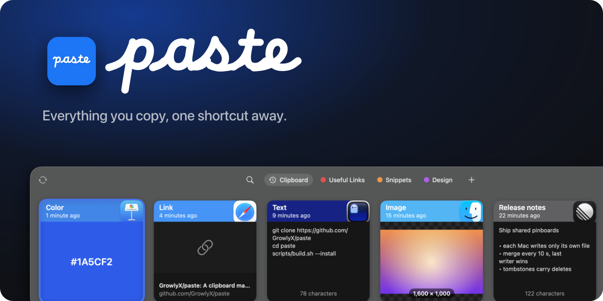

<p align="center">
  
</p>

<p align="center">
  <a href="https://github.com/GrowlyX/paste/actions/workflows/ci.yml"></a>
  <a href="https://github.com/GrowlyX/paste/releases/latest"></a>
  
  <a href="LICENSE"></a>
</p>

Paste keeps everything you copy (text, links, images, files and colors) and
brings it back with one shortcut. Press **⇧⌘V** anywhere: a shelf of cards slides
up from the bottom of the screen. Pick one and it lands in the app you were using.

```sh
git clone https://github.com/GrowlyX/paste && cd paste
make install        # builds Paste.app, copies it to /Applications and opens it
```

- **Shelf**: full-width, keyboard-first, and it never steals focus from the app you're pasting into.
- **Search**: just start typing. Filter by type or by the app something came from.
- **Pinboards**: keep snippets, links and assets around for good, and share a pinboard with other people.
- **Paste Stack**: copy several things, then paste them back in order with ⌘V, ⌘V, ⌘V.
- **Drag and drop**: select several cards and drop them into any app as one paste.
- **iCloud sync** between your Macs, with no account or server.
- **Private**: skips password managers and concealed content, pauses on demand, and keeps your history on your Mac.

## Docs

- [Install](docs/install.md): download a release or build from source, permissions, uninstalling
- [Using the shelf](docs/shelf.md): opening it, keyboard and mouse, search, quick paste, drag and drop
- [Pinboards](docs/pinboards.md): organizing, sharing a pinboard through a shared folder
- [Paste Stack](docs/paste-stack.md): collect, then paste in sequence
- [Sync](docs/sync.md): how iCloud sync works and what it stores
- [Settings and privacy](docs/settings.md): every setting, ignored apps, where data lives
- [Development](docs/development.md): building, the demo library, the icon, sounds and banner, CI and releases

## Credits

The wordmark and icon are set in
[Macintosh Skeletal Filled](https://github.com/npwitk/Macintosh-Skeletal-Filled),
an unofficial font derived from Apple's Macintosh Skeletal and shared for
personal, non-commercial use. The repository ships only rendered artwork
(outlines and PNGs), never the font file. Paste is not affiliated with Apple.

## License

[BSD 3-Clause](LICENSE)
